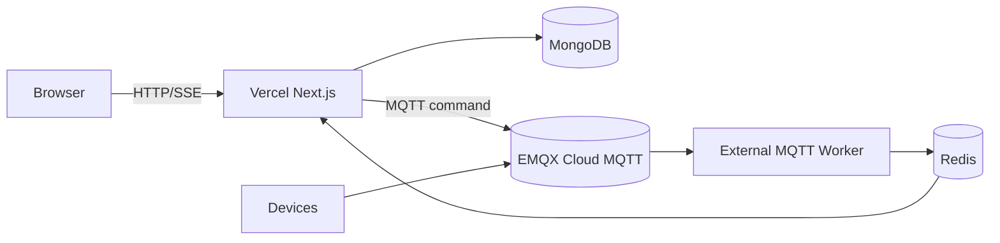

# IoT Digital Twin Farm Management System

A digital twin for farm automation. See your farm on a live visual layout and turn pumps and valves on or off from the dashboard.

**Built with:** Next.js 16 · React 19 · TypeScript · Tailwind CSS · React-Konva · Prisma 6.19.3 + MongoDB · Redis · MQTT · same-origin Server-Sent Events (SSE) at `/api/realtime/stream`, deployed on Vercel.

**Deployed at:** https://iot-automation-rho.vercel.app

> Keep Prisma pinned to `6.19.3`. Prisma 7 has no MongoDB connector.

---

## How it works

| Process | Command | What it does |
| --- | --- | --- |
| Web/API/SSE | `npm run dev` locally, Vercel in production | Dashboard, login, APIs, layout editor, device commands, and same-origin `/api/realtime/stream` |
| MQTT worker | `npm run mqtt:worker` | Runs outside Vercel on a long-lived host; subscribes to cloud MQTT, caches status in Redis, republishes telemetry/status through Redis Pub/Sub, and runs the stale-sensor watchdog |
| Simulator (optional) | `npm run simulate:moisture` | Publishes fake device telemetry/status over MQTT for testing |
| Legacy WS/health service (optional) | `npm run ws:server` | Optional WebSocket stream on `:3001/ws` with `:3001/health` endpoints; not used by the Vercel dashboard |



All long-running processes must share the same MongoDB, Redis, MQTT, and JWT settings. Vercel runs the web app, APIs, and SSE stream only.

---

## Features

- **Green & White dashboard** with a responsive sidebar, role-aware navigation, and logout with confirmation.
- **Digital twin layout:** `1200x800` React-Konva canvas with device placements, background items, flow connections, drag-to-arrange editing, and fullscreen viewing.
- **Remote device control:** double-click a pump or valve to open a green confirmation modal, then publish `ON` or `OFF` through cloud MQTT.
- **Live visuals:** device status updates over SSE, animated raindrops when a rain detector reports `RAINING`, plus `STALE` and `OFFLINE` states.
- **Layout versioning:** saves are conflict-safe; a stale save returns `409` so the editor can be reloaded before saving again.
- **Admin management:** admin-only users, farms, and layout routes. Users can only access their own farms.
- **Auth:** HttpOnly access/refresh cookies, refresh rotation, session-family revocation, and confirmed logout.

---

## Screenshots

- **Digital Twin Layout:** `docs/screenshots/dashboard-canvas.png` — Green & White `1200×800` farm canvas with pumps, valves, and live telemetry.
- **Rain & Stale Watchdog:** `docs/screenshots/rain-and-stale.png` — Raindrop visual state (`RAINING`) and `60s` stale sensor indicator (`STALE`).

---

## Data model

- **User** has a role: `ADMIN` or `USER`.
- **Farm** belongs to one user.
- **Device** belongs to one farm.
- **FarmLayout** is one per farm (canvas `1200x800`, with placements, background items, and flow connections).

Controllable device types: `PUMP`, `MOTOR_PUMP`, `VALVE`, `SOLENOID_VALVE`.

Layout saves use a version number. A stale save returns `409`, so reload before saving again. Choosing **publish** also creates real `Device` records for preset placements.

---

## Cloud MQTT remote control

Production does not rely on a local broker or same-network device control. The Vercel web app publishes pump/valve `ON`/`OFF` commands to EMQX Cloud, and the external MQTT worker plus devices can connect from other networks.

Primary production broker URL:

```text
mqtts://<user>:<password>@<host>:8883
```

If TCP `8883` is blocked by a network or firewall, use the EMQX Cloud WebSocket Secure fallback:

```text
wss://<user>:<password>@<host>:8084/mqtt
```

Use the same encoded broker URL in Vercel and in the external MQTT worker. In production, `MQTT_BROKER_URL` must use `mqtts://` or `wss://` and include credentials; anonymous brokers are rejected by `src/lib/mqttClient.ts`.

---

## MQTT topics

| Purpose | Topic | Sent by |
| --- | --- | --- |
| Command | `farm/{farmId}/device/{deviceId}/command` | Web API |
| Status | `farm/{farmId}/device/{deviceId}/status` | Device or UI command cache |
| Telemetry | `farm/{farmId}/device/{deviceId}/telemetry` | Device |

**MQTT payload examples**

```json
{ "state": "ON" }
{ "state": "OFF" }
{ "state": "ONLINE", "pumpOn": true }
{ "state": "ONLINE", "valveOpen": false }
{ "state": "RAINING" }
{ "moisture": 52 }
```

The command API body is `{ "command": "ON" }` or `{ "command": "OFF" }`; the app publishes `{ "state": "ON" }` or `{ "state": "OFF" }` to the command topic with QoS 1 and waits for broker acknowledgement.

Other states: `OFFLINE`, `STALE`.

---

## EMQX credentials and ACLs

`MQTT_BROKER_URL` is a URL, so special characters in the password must be percent-encoded:

| Character | Encoded |
| --- | --- |
| `@` | `%40` |
| `#` | `%23` |
| `:` | `%3A` |

For example, `p@ss#1:2` should be written as `p%40ss%231%3A2` inside the broker URL. An unencoded `@` is parsed as the host separator and will break authentication.

Required EMQX ACL rules:

| Action | Topic filter |
| --- | --- |
| `publish` | `farm/+/device/+/command` |
| `subscribe` | `farm/+/device/+/status` |
| `subscribe` | `farm/+/device/+/telemetry` |

The web app needs the publish rule for commands. The external MQTT worker needs both subscribe rules.

---

## Live flows

**Command:** Double-click a pump/valve → green confirmation modal → API checks access and device type → publishes MQTT command with QoS 1 → UI updates optimistically → real device status replaces it.

**Status:** Device or command result → cloud MQTT → external worker → Redis cache and Pub/Sub → `/api/realtime/stream` SSE → dashboard.

**Telemetry:** Device → cloud MQTT → external worker → Redis Pub/Sub → SSE → dashboard. Telemetry is live-only and is not cached as the latest value.

**Stale watchdog:** The worker checks telemetry last-seen timestamps every 10 seconds. A sensor with no telemetry for 60 seconds is marked `STALE`; when telemetry returns, it is marked `ONLINE`.

**Rain:** A `RAIN_DETECTION` device reporting `RAINING` enables animated raindrops over the published layout.

**SSE client:** Reconnects automatically; the browser's `EventSource` handles retries.

---

## Security

- **Login:** Access token (15 min) and refresh token (7 days), both in HttpOnly cookies with `Path=/`, `SameSite=Lax`, and `Secure` in production. Tokens are never in the response body.
- **Refresh session:** One refresh session is stored per user in Redis. Refresh tokens rotate on every use while keeping the same family ID.
- **Family revocation:** Reusing an already-rotated refresh token from the current family revokes the whole session family.
- **New login:** A new login replaces the stored single session; refresh tokens from an older login are rejected because their family no longer matches.
- **Logout:** `POST /api/auth/logout` revokes the refresh session family and clears both auth cookies.
- **Roles:** `USER` sees only their own farms. `ADMIN` can manage everything, but can't demote or delete themselves, and at least one admin must remain.
- **Realtime stream:** Checks access token and farm ownership before opening the SSE connection.
- **MQTT in production:** Must use `mqtts://` or `wss://` with a username and password. Set least-privilege ACLs on the broker.

**Not built in yet (add at platform level):** rate limiting, CSP/security headers, audit trail.

---

## API quick reference

| Area | Routes |
| --- | --- |
| Auth | `POST /api/auth/login` · `POST /api/auth/refresh` · `POST /api/auth/logout` · `POST /api/auth/register` (admin) |
| Farms | `GET/POST /api/farms` · `GET/PATCH/DELETE /api/farms/{id}` |
| Devices | `GET/POST /api/devices` · `GET/PATCH/DELETE /api/devices/{id}` |
| Command | `POST /api/devices/{id}/command` with `{ "command": "ON" }` |
| Layout | `GET /api/layout?email=` |
| Dashboard realtime SSE | `GET /api/realtime/stream?farmId=` |
| Telemetry SSE | `GET /api/telemetry/stream?farmId=&deviceId=` |
| Admin | `/api/admin/farms`, `/api/admin/farms/{id}/layout` (GET/PUT), `/api/admin/users/{id}` |
| Optional WS/health service | `GET :3001/health` · `GET :3001/health/ready` only when `npm run ws:server` is running |

Errors always look like `{ "error": "message" }`.

---

## Quick start

**Needs:** Node 22 (20.9+ works), MongoDB, Redis, and an MQTT broker. For local development, a local broker such as `mqtt://localhost:1883` is fine; production requires secure cloud MQTT credentials.

```bash
npm install
cp .env.example .env
npm run db:generate
npm run db:push
```

**Key environment variables**

```text
DATABASE_URL="mongodb://localhost:27017/iot-automation"
REDIS_URL="redis://localhost:6379"
JWT_ACCESS_SECRET="long-random-value"
JWT_REFRESH_SECRET="different-long-random-value"
MQTT_BROKER_URL="mqtt://localhost:1883"
WS_PORT="3001"
WEBSOCKET_ALLOWED_ORIGINS="http://localhost:3000"
```

`WS_PORT` and `WEBSOCKET_ALLOWED_ORIGINS` are only for the optional standalone WebSocket/health server. The dashboard uses same-origin SSE, so no separate WebSocket host or `NEXT_PUBLIC_WS_URL` is required.

Generate a secret:

```bash
node -e "console.log(require('crypto').randomBytes(48).toString('hex'))"
```

The simulator also needs `FARM_ID`, `DEVICE_ID`, `PUMP_DEVICE_ID`, `VALVE_1_DEVICE_ID`, `VALVE_2_DEVICE_ID`, and `RAIN_DEVICE_ID`.

**Create the first admin:** There is no sign-up page. Hash a password, then insert a user in MongoDB:

```bash
node -e "console.log(require('bcryptjs').hashSync('change-me', 12))"
```

```json
{ "name": "Administrator", "email": "admin@example.com", "password": "<hash>", "role": "ADMIN" }
```

**Run it** (one terminal each):

```bash
npm run dev
npm run mqtt:worker
npm run simulate:moisture   # optional
```

Open `http://localhost:3000`. In production, use `npm run build && npm run start`, and run the MQTT worker separately. The dashboard streams realtime updates from its own `/api/realtime/stream` route; `npm run ws:server` is optional and not used by the dashboard.

---

## Vercel deployment

Vercel runs the Next.js web app, APIs, and SSE stream. It does not run the MQTT worker. Run `npm run mqtt:worker` separately on a long-lived host such as a VPS, Railway, Render, or Fly, with the same MongoDB, Redis, MQTT, and JWT settings.

Production URL: https://iot-automation-rho.vercel.app

Vercel build settings:

- Framework: Next.js
- Build command: `npm run build`
- Install command: `npm install`
- Output: default/auto

Set these in **Vercel Project Settings → Environment Variables**:

```text
DATABASE_URL="mongodb+srv://<user>:<password>@<cluster>/iot-automation"
REDIS_URL="rediss://default:<password>@<endpoint>:<port>"
JWT_ACCESS_SECRET="long-random-value"
JWT_REFRESH_SECRET="different-long-random-value"
MQTT_BROKER_URL="mqtts://<user>:<password>@<host>:8883"
MQTT_CACHE_TTL_SECONDS="86400"
```

If EMQX Cloud TCP `8883` is unavailable, use the WSS fallback in both Vercel and the worker:

```text
MQTT_BROKER_URL="wss://<user>:<password>@<host>:8084/mqtt"
```

Remember to percent-encode password characters such as `@`, `#`, and `:` inside `MQTT_BROKER_URL`. Apply the EMQX ACL rules listed above.

Do not set `NEXT_PUBLIC_WS_URL`. Vercel does not need `WS_PORT` or `WEBSOCKET_ALLOWED_ORIGINS`; the dashboard uses same-origin SSE at `/api/realtime/stream`.

Redeploy after changing Vercel env vars, and restart the external MQTT worker after changing its env vars. Confirm the SSE response uses `Content-Type: text/event-stream` and is not buffered by a proxy.

---

## Optional WebSocket / health service

`npm run ws:server` starts the legacy WebSocket service on `WS_PORT` (default `3001`) and serves:

- `GET /health`
- `GET /health/ready`
- `ws://<host>:<port>/ws`

These `:3001` health endpoints belong only to this optional WebSocket/health service. They are not Vercel routes and are not served by `npm run mqtt:worker`. The Vercel dashboard does not require this service.

---

## Simulator

`hardware-similator.js` publishes fake data over MQTT only. It sends moisture every `INTERVAL_MS` (default 1s) and repeats a 46-second cycle of valve, pump, and rain events. Stop it with Ctrl+C.

---

## Testing

```bash
npm test && npm run lint && npm run typecheck && npm run build
npx prisma validate
```

**Quick live check:** Start the web app and MQTT worker (plus the simulator for test data), sign in, confirm the moisture gauge moves, double-click a pump/valve and confirm the command, stop the simulator for 60+ seconds to see `STALE`, and verify `/api/realtime/stream`. If the optional WS/health service is running, also check `:3001/health/ready`.

Smoke-test MQTT:

```bash
mosquitto_pub -h <host> -p 8883 -u <user> -P <pass> -q 1 \
  -t "farm/<farmId>/device/<deviceId>/telemetry" -m '{"moisture":52}'
```

---

## Troubleshooting

| Problem | Fix |
| --- | --- |
| Keeps redirecting to `/login` | Check `JWT_ACCESS_SECRET`, the `access_token` cookie, and cookie expiry |
| `/admin` sends you to `/` | The user's role isn't `ADMIN` |
| Dashboard says "reconnecting" | Check `/api/realtime/stream`, `REDIS_URL`, and that the MQTT worker is running |
| SSE stream `401` | Sign in again; secrets must match across web processes |
| SSE stream `404` | Farm not found, or not yours |
| Gauge empty | Start the worker and simulator; check topic, sensor ID, and EMQX subscribe ACL |
| `Unable to complete send device command` | Check `MQTT_BROKER_URL`, password URL-encoding, `mqtts`/`wss`, EMQX publish ACL, device ID, and device type |
| Commands fail only on one network | Try the WSS fallback `wss://<user>:<password>@<host>:8084/mqtt` |
| Sensor never returns from `STALE` | Check telemetry topic, worker logs, and `telemetry:last-seen:*` keys in Redis |
| Layout save `409` | Reload the layout, then save again |
| Prisma errors | Use `6.19.3`; run `db:generate` and `db:push` |
| `:3001/health/ready` is `503` | The optional WS/health service is running but MongoDB, Redis, or MQTT is unhealthy |
| Logout doesn't end the session | Check the `refresh_token` cookie, Redis availability, and `POST /api/auth/logout` |

---

## Production checklist

- Node 22, with the external MQTT worker supervised and set to restart; Vercel runs the web/API/SSE processes
- On Vercel, set all runtime env vars in Project Settings and use encoded EMQX credentials
- HTTPS everywhere, and separate strong JWT secrets in a secret manager
- MongoDB with TLS, auth, allowlist, and backups
- Redis with AUTH/TLS and Pub/Sub
- EMQX Cloud over `mqtts://...:8883` or `wss://...:8084/mqtt`, anonymous access off, and least-privilege ACLs
- Proxy allows long-lived SSE responses without buffering
- Monitor Vercel `/api/realtime/stream`; monitor `:3001/health` and `:3001/health/ready` only if the optional WS/health service is deployed
- Logs centralized
- Rate limiting and WAF set up at the edge

---

## Good to know

- Only status is cached in Redis; telemetry is live-only.
- The dashboard shows the first published farm (oldest first).
- Deleting or moving a device doesn't update saved layouts. Reopen and republish.
- One refresh session is stored per user; a new login replaces that stored session and older refresh tokens are rejected.
- Refresh rotation keeps the same family; reusing an already-rotated refresh token from that family revokes the whole family.
- Logout clears both auth cookies and revokes the refresh session family.
- The dashboard uses same-origin SSE, so no separate WebSocket host or `NEXT_PUBLIC_WS_URL` is required.
- `:3001/health` and `:3001/health/ready` belong to the optional WebSocket/health service, not Vercel or the MQTT worker.
