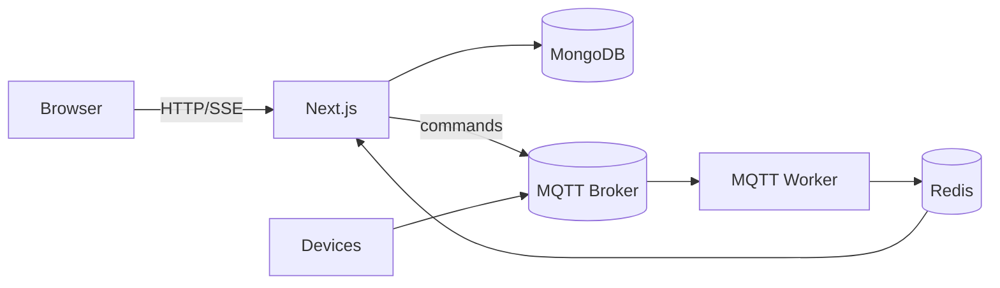

# IoT Farm Management System

A digital twin for farm automation. See your farm on a live visual layout and turn pumps and valves on or off from the dashboard.

**Built with:** Next.js 16 · React 19 · TypeScript · Tailwind · React-Konva · Prisma + MongoDB · Redis · MQTT · Server-Sent Events (SSE)

**Deployed at:** https://iot-automation-rho.vercel.app

> Keep Prisma pinned to `6.19.3`. Prisma 7 has no MongoDB connector.

---

## How it works

Three processes run together:

| Process | Command | What it does |
| --- | --- | --- |
| Web/API/SSE | `npm run dev` | Dashboard, login, APIs, layout editor, sends commands, streams live updates |
| MQTT worker | `npm run mqtt:worker` | Listens to devices, caches status, flags stale sensors |
| Simulator (optional) | `npm run simulate:moisture` | Fake devices for testing |



All server processes must share the same MongoDB, Redis, MQTT, and JWT settings.

---

## Data model

- **User** has a role: `ADMIN` or `USER`.
- **Farm** belongs to one user.
- **Device** belongs to one farm.
- **FarmLayout** is one per farm (canvas 1200×800, with placements, background items, and flow connections).

Controllable devices: `PUMP`, `MOTOR_PUMP`, `VALVE`, `SOLENOID_VALVE`.

Layout saves use a version number. A stale save returns `409`, so reload before saving again. Choosing **publish** also creates real `Device` records for preset placements.

---

## MQTT topics

| Purpose | Topic | Sent by |
| --- | --- | --- |
| Command | `farm/{farmId}/device/{deviceId}/command` | Web API |
| Status | `farm/{farmId}/device/{deviceId}/status` | Device |
| Telemetry | `farm/{farmId}/device/{deviceId}/telemetry` | Device |

**Payload examples**

```json
{ "state": "ON" }                              // command
{ "state": "ONLINE", "pumpOn": true }          // pump status
{ "state": "ONLINE", "valveOpen": false }      // valve status
{ "state": "RAINING" }                         // rain detected
{ "moisture": 52 }                             // telemetry
```

Other states: `OFFLINE`, `STALE`.

---

## Live flows

**Command:** Double-click a device → confirm → API checks access → publishes MQTT (QoS 1) → UI updates right away → the real device status replaces it.

**Status:** Device → MQTT → worker → Redis → SSE API → dashboard.

**Telemetry:** Same path, but live-only (not cached). The worker marks a sensor `STALE` after 60 seconds of silence (checked every 10s), and sends `ONLINE` when data returns.

**SSE client:** Reconnects automatically; the browser's `EventSource` handles retries.

---

## Security

- **Login:** Short-lived access token (15 min) and refresh token (7 days), both in HttpOnly cookies. Tokens are never in the response body.
- **Refresh:** Tokens rotate on every use. Reusing an old one revokes the whole session family.
- **Logout:** `POST /api/auth/logout` revokes the refresh session family and clears both auth cookies.
- **Roles:** `USER` sees only their own farms. `ADMIN` can manage everything, but can't demote or delete themselves, and at least one admin must remain.
- **Realtime stream:** Checks access token and farm ownership before opening the SSE connection.
- **MQTT in production:** Must use `mqtts://` or `wss://` with a username and password. Set per-device ACLs on the broker.

**Not built in yet (add at platform level):** rate limiting, CSP/security headers, audit trail.

---

## API quick reference

| Area | Routes |
| --- | --- |
| Auth | `POST /api/auth/login` · `/refresh` · `/logout` · `/register` (admin) |
| Farms | `GET/POST /api/farms` · `GET/PATCH/DELETE /api/farms/{id}` |
| Devices | `GET/POST /api/devices` · `GET/PATCH/DELETE /api/devices/{id}` |
| Command | `POST /api/devices/{id}/command` with `{ "command": "ON" }` |
| Layout | `GET /api/layout?email=` |
| Dashboard realtime SSE | `GET /api/realtime/stream?farmId=` |
| Telemetry SSE | `GET /api/telemetry/stream?farmId=&deviceId=` |
| Admin | `/api/admin/farms`, `/api/admin/farms/{id}/layout` (GET/PUT), `/api/admin/users/{id}` |
| Health | `GET :3001/health` · `GET :3001/health/ready` |

Errors always look like `{ "error": "message" }`.

---

## Quick start

**Needs:** Node 22 (20.9+ works), MongoDB, Redis, an MQTT broker.

```bash
npm install
cp .env.example .env
npm run db:generate
npm run db:push
```

**Key environment variables**

```text
DATABASE_URL="mongodb://localhost:27017/iot-automation"
REDIS_URL="redis://localhost:6379"
JWT_ACCESS_SECRET="long-random-value"
JWT_REFRESH_SECRET="different-long-random-value"
MQTT_BROKER_URL="mqtt://localhost:1883"
WS_PORT="3001"
WEBSOCKET_ALLOWED_ORIGINS="http://localhost:3000"
```

`WS_PORT` and `WEBSOCKET_ALLOWED_ORIGINS` are only for the optional standalone WebSocket server. The dashboard uses same-origin SSE, so no separate WebSocket host or `NEXT_PUBLIC_WS_URL` is required.

Generate a secret:

```bash
node -e "console.log(require('crypto').randomBytes(48).toString('hex'))"
```

The simulator also needs `FARM_ID`, `DEVICE_ID`, `PUMP_DEVICE_ID`, `VALVE_1_DEVICE_ID`, `VALVE_2_DEVICE_ID`, and `RAIN_DEVICE_ID`.

**Create the first admin:** There is no sign-up page. Hash a password, then insert a user in MongoDB:

```bash
node -e "console.log(require('bcryptjs').hashSync('change-me', 12))"
```

```json
{ "name": "Administrator", "email": "admin@example.com", "password": "<hash>", "role": "ADMIN" }
```

**Run it** (one terminal each):

```bash
npm run dev
npm run mqtt:worker
npm run simulate:moisture   # optional
```

Open `http://localhost:3000`. In production, use `npm run build && npm run start`, and run the MQTT worker separately. The dashboard streams realtime updates from its own `/api/realtime/stream` route; `npm run ws:server` is optional and not used by the dashboard.

---

## Vercel deployment

Vercel runs the Next.js web app, APIs, and SSE stream. It does not run the MQTT worker. Run `npm run mqtt:worker` separately on a long-lived host such as a VPS, Railway, Render, or Fly, with the same MongoDB, Redis, MQTT, and JWT settings.

Production URL: https://iot-automation-rho.vercel.app

Vercel build settings:

- Framework: Next.js
- Build command: `npm run build`
- Install command: `npm install`
- Output: default/auto

Set these in **Vercel Project Settings → Environment Variables**:

```text
DATABASE_URL="mongodb+srv://<user>:<password>@<cluster>/iot-automation"
REDIS_URL="rediss://default:<password>@<endpoint>:<port>"
JWT_ACCESS_SECRET="long-random-value"
JWT_REFRESH_SECRET="different-long-random-value"
MQTT_BROKER_URL="mqtts://<user>:<password>@<host>:8883"
MQTT_CACHE_TTL_SECONDS="86400"
```

`MQTT_BROKER_URL` must use `mqtts://` or `wss://` with a username and password in production. Anonymous brokers are rejected. The broker user needs publish access to `farm/+/device/+/command` and subscribe access to `farm/+/device/+/status` and `farm/+/device/+/telemetry`.

Do not set `NEXT_PUBLIC_WS_URL`. Vercel does not need `WS_PORT` or `WEBSOCKET_ALLOWED_ORIGINS`; the dashboard uses same-origin SSE at `/api/realtime/stream`.

Redeploy after changing Vercel env vars, and restart the external MQTT worker after changing its env vars. Confirm the SSE response uses `Content-Type: text/event-stream` and is not buffered by a proxy.

---

## Simulator

`hardware-similator.js` publishes fake data over MQTT only. It sends moisture every `INTERVAL_MS` (default 1s) and repeats a 46-second cycle of valve, pump, and rain events. Stop it with Ctrl+C.

---

## Testing

```bash
npm test && npm run lint && npm run typecheck && npm run build
npx prisma validate
```

**Quick live check:** Start the web app and MQTT worker (plus the simulator for test data), sign in, confirm the moisture gauge moves, stop the simulator for 60+ seconds to see `STALE`, then check `/health/ready`.

Smoke-test MQTT:

```bash
mosquitto_pub -h <host> -p 8883 -u <user> -P <pass> -q 1 \
  -t "farm/<farmId>/device/<deviceId>/telemetry" -m '{"moisture":52}'
```

---

## Troubleshooting

| Problem | Fix |
| --- | --- |
| Keeps redirecting to `/login` | Check `JWT_ACCESS_SECRET` and the `access_token` cookie |
| `/admin` sends you to `/` | The user's role isn't `ADMIN` |
| Dashboard says "reconnecting" | Check `/api/realtime/stream`, `REDIS_URL`, and that the MQTT worker is running |
| SSE stream `401` | Sign in again; secrets must match across processes |
| SSE stream `404` | Farm not found, or not yours |
| Gauge empty | Start the worker and simulator; check topic and sensor ID |
| Commands don't arrive | Check broker URL, ACLs, device ID, and device type |
| Layout save `409` | Reload the layout, then save again |
| Prisma errors | Use `6.19.3`; run `db:generate` and `db:push` |
| `/health/ready` is `503` | See which dependency is unhealthy in the response |

---

## Production checklist

- Node 22, with the web app and MQTT worker supervised and set to restart; add the optional WebSocket server only if used
- On Vercel, set all runtime env vars in Project Settings and run the MQTT worker outside Vercel
- HTTPS everywhere, and separate strong JWT secrets in a secret manager
- MongoDB with TLS, auth, allowlist, and backups
- Redis with AUTH/TLS and Pub/Sub
- MQTT over TLS, anonymous access off, least-privilege ACLs
- Proxy allows long-lived SSE responses without buffering
- `/health` and `/health/ready` monitored; logs centralized
- Rate limiting and WAF set up at the edge

---

## Good to know

- Only status is cached in Redis; telemetry is live-only.
- The dashboard shows the first published farm (oldest first).
- Deleting or moving a device doesn't update saved layouts. Reopen and republish.
- One refresh session per user; a new login replaces the old one.
- Logout clears both auth cookies and revokes the refresh session family.
- The dashboard uses SSE on the same origin, so no separate WebSocket host is required.